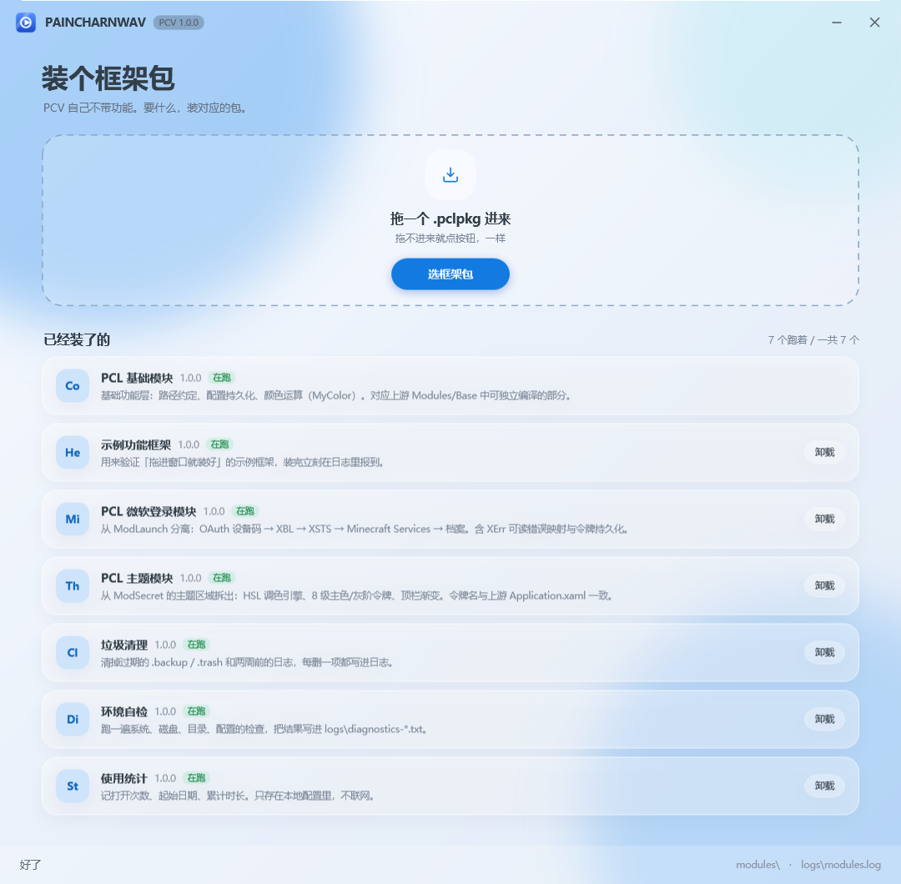
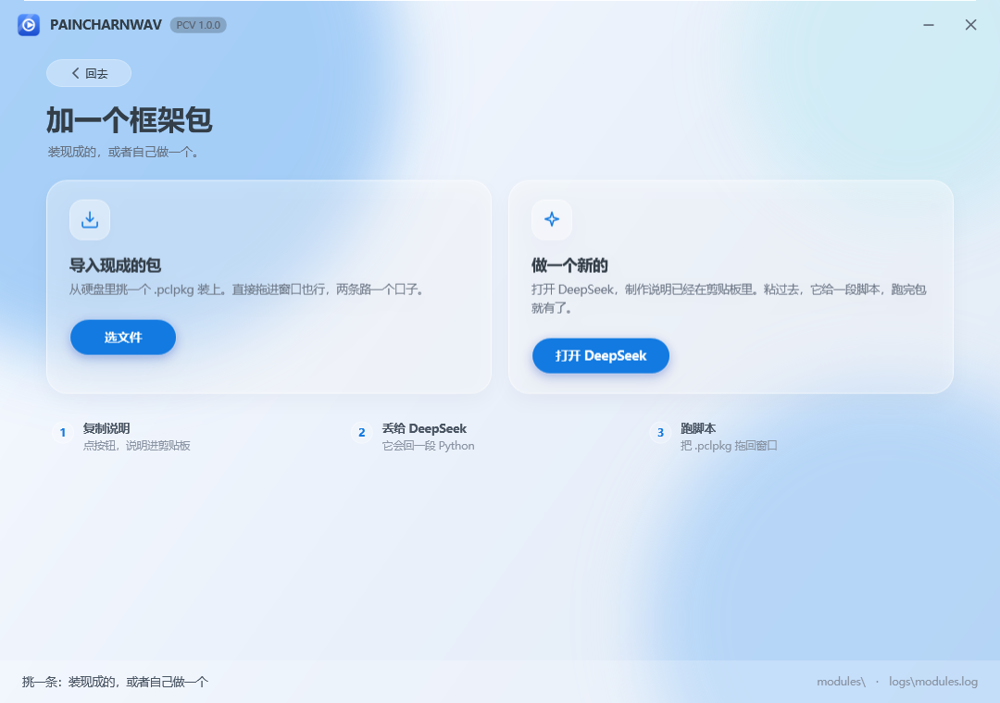
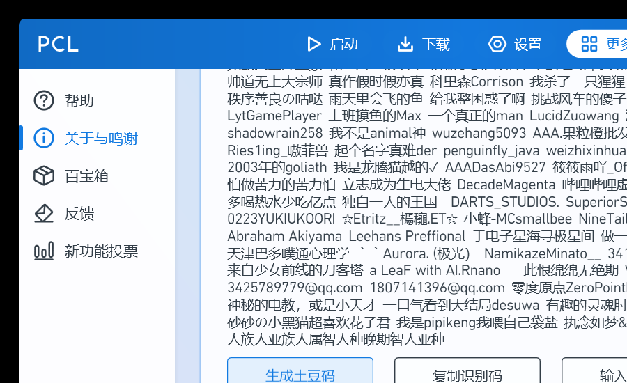

# PAINCHARNWAV（PCV）

> **仓库：<https://github.com/150311-ma/PCV>**
>
> **源代码以 [MIT](LICENSE) 开源**——能做什么、不能做什么、名字能不能用，见 [OPEN-SOURCE.md](OPEN-SOURCE.md)。
>
> **这是第三方基于 [PCL](https://github.com/Meloong-Git/PCL) 的独立二次创作**，与 PCL 官方无关。
> 2.0.0 起代码已全部重写，不含上游源码；[`LICENCE-PCL`](LICENCE-PCL) 作为来源记录保留。


> 名字：**PAINCHARNWAV**，日常叫 **PCV**。代码里的 `pcl.*` 模块 Id 没改——那是底层框架的名字，
> 改它等于把所有已装包的路径全打乱，不值当。

把 PCL（Plain Craft Launcher 2，VB.NET / .NET Framework 4.8 / WPF）从**单程序集全局状态**
改成**模块加载器 + 契约 + 独立模块**的结构，再在外面套一层自己的壳。

本目录是改造后的骨架，**不动**仓库里原有的 `Plain Craft Launcher 2/` 单体工程：
它作为对照实现保留，随时可以和上游 `Meloong-Git/PCL` 同步，不会因为改造而失去追溯能力。

## 一、为什么不能"直接把文件搬到新工程"

PCL 原本是一个程序集里的全局状态机：

- 页面直接读 `ModMain`、`States`、`FrmMain.PanXXX`；
- 模块之间互相 `Public Module` 直接调用，没有接口；
- 主题靠直接改 `Application.Current.Resources` 并抓住 `FrmMain.PanTitle`。

所以"拆"不是挪文件，而是**先立契约，再让代码只依赖契约**。本次改造按这个顺序落地：
先做契约与加载器，再把可以独立的部分（基础功能 / 主题 / 微软登录）真正编成独立程序集，
最后才动 UI（UI 依赖面最大，见各 UI 仓库的 `MIGRATION.md`）。

## 二、目录

```
modular/
├── Pcv.sln
├── src/
│   ├── Pcv.Modular.Abstractions/   契约：IPclModule、清单、服务表、跨模块接口
│   ├── Pcv.Modular.Host/           模块加载器（本目录的主角）
│   ├── Pcv.Modular.Cli/            加载器验证器（含故障注入用例）
│   ├── PCL.Core/                   基础模块：路径、配置、MyColor
│   ├── PCL.Theme/                  主题模块：HSL 调色 + 资源注入
│   ├── Pcv.Launch.Microsoft/       微软登录模块：设备码 → XBL → XSTS → MC
│   └── Pcv.Shell/                  壳程序：只有窗口和加载逻辑，没有业务代码
└── verify.cmd                      一键构建 + 两组验证
```

模块之间**不互相引用程序集**：需要别人的能力，就从 `IModuleContext.Services` 按接口取。
跨模块接口统一放在 `Pcv.Modular.Abstractions/Contracts.cs`。

## 三、模块清单

| 模块 Id | 工程 | 依赖 | 对应上游 | 状态 |
| --- | --- | --- | --- | --- |
| `pcv.core` | Pcv.Core.csproj | — | 自己写的：路径约定、JSON 配置、颜色换算 | ✅ |
| `pcv.theme` | Pcv.Theme.csproj | pcv.core | 自己写的：12 套配色 + 令牌写资源 | ✅ |
| `pcv.launch.microsoft` | Pcv.Launch.Microsoft.vbproj | 独立 | **唯一保留的上游衍生模块**：`ModLaunch.McLoginMsStart` / `MsLoginStep1~6` | ✅ |
| `pcv.diagnostics` | Pcv.Diagnostics.csproj | pcv.core | 新增 | ✅ |
| `pcv.stat` | Pcv.Stat.csproj | pcv.core | 新增 | ✅ |
| `pcv.cleaner` | Pcv.Cleaner.csproj | pcv.core | 新增 | ✅ |
| `pcv.demo.hello` | Pcv.Demo.Hello.vbproj | pcv.core | 示例 | ✅ |


UI 模块在独立仓库里，见 `ARCHITECTURE.md` 的仓库表。

## 四、跑起来是什么样

整个程序**只有一页**：拖包 → 装 → 立刻可用。左边是刚启动的样子，右边是拖进示例框架之后的样子。

| 首页 | 点"选框架包"之后的第二页 |
| --- | --- |
|  |  |

两张图都是同一份代码离屏渲染出来的（`--render`），不是画的效果图。

## 五、构建与验证
```bat
cd modular
dotnet build Pcv.sln
```

一键验证（构建 + 故障注入 + 真实模块加载）：

```bat
modular\verify.cmd
```

单独跑：

```bat
:: 真实模块
src\Pcv.Modular.Cli\bin\Debug\Pcv.Modular.Cli.exe --modules src\Pcv.Shell\bin\Debug\modules

:: 故障注入：造出坏 JSON / 缺 dll / OnLoad 抛异常 / 循环依赖 / 重复 Id，确认加载器会判红
src\Pcv.Modular.Cli\bin\Debug\Pcv.Modular.Cli.exe --inject-fault
```

界面（离屏渲染，不需要人盯着看）：

```bat
src\Pcv.Shell\bin\Debug\Pcv.Shell.exe --render preview.png --theme violet
```

## 六、加载器规则（刻意做成可判定）

1. **只认 `module.json`**，不扫程序集特性，不猜约定；
2. **依赖拓扑排序**，循环依赖整组判失败，不做"尽力加载"；
3. **单个模块失败只影响它和它的下游**：下游标记为"已跳过"并写明是哪个依赖挂了；
4. **重复 Id 只保留最高版本**，其余显式记失败（不允许悄悄生效）；
5. **`OnStart` 逆序 `OnStop`**，退出时按依赖反向收尾。

这些规则每一条都有对应的注入用例，`--inject-fault` 会逐条验证。

## 七、本体工程翻新

`Plain Craft Launcher 2/Plain Craft Launcher 2.vbproj` 从老式工程（ToolsVersion 15、逐个文件列举）改成 SDK 风格，
现在**不用装 Visual Studio 也能 `dotnet build`**：

| 项 | 翻新前 | 翻新后 |
| --- | --- | --- |
| 文件清单 | 手工维护 112 个 `<Compile>` / 60 个 `<Page>` / 52 个 `<Resource>` | MSBuild 自动收集 |
| 配置 | Debug 与 Snapshot 都定义 `SNAPSHOT`，靠 VS 切换 | Debug / Release / Snapshot 三个条件组，一眼看清 |
| 参考程序集 | 依赖机器上装 VS 的 .NET Framework Developer Pack | 引 `Microsoft.NETFramework.ReferenceAssemblies` 包，任何机器 `dotnet build` 可编 |
| 全局 Imports | 30 条 | 原样保留（代码里从不写 Imports，少一条就是成片"未定义类型"） |

翻新时踩到、并且已经写进工程注释的三个坑：

1. **自动 glob 不等于老工程清单**。`Controls/MySliderDot.xaml(.vb)` 在磁盘上，但老工程从来没编译过它
   （引用了 `MathRange` / `SetTop` / `FrmMain.SliderDrag_Finish` 等根本不存在的成员，是上游遗留的死文件）。
   SDK 会自动把它捡进来，必须显式 `Remove`。核对方法：老工程 `<Compile>` 112 条 vs 磁盘 113 个 `.vb`，差的就是它。
2. **`Application.xaml` 不叫 `App.xaml`**。SDK 默认只把 `App.xaml` 当 `ApplicationDefinition`，
   这里要关掉默认项再显式声明，否则会被当成普通 Page，`Main` 就没了。
3. **`AssemblyName` 必须保持 `Plain Craft Launcher 2`**。代码里所有
   `pack://application:,,,/Plain Craft Launcher 2;component/Images/...` 都靠它，改名等于全站图片失联。

验证结果：

- `dotnet build` → **0 警告 0 错误**，产出 `bin\Plain Craft Launcher 2.exe` 与全部依赖；
- 直接启动本体，`PCL\Log1.txt` 里能看到完整的初始化链路（模块加载 → Java 扫描 → 版本列表拉取 → 主窗口 DPI），
  界面正常渲染：



## 八、单页 + 功能框架包（2026-11-05 追加）

### 只有一页

壳里没有导航、没有侧边栏、没有设置页。页面上只有三件事：
**拖放区**（拖 .pclpkg 进来）、**已装框架列表**、**状态栏**。
所有能力都来自 `modules/`，壳自己不含任何业务逻辑。

### 包格式 `.pclpkg`

就是一个 zip，根目录放 `module.json`（允许套一层文件夹）：

```
module.json          # id / name / version / assembly / entry / dependencies
PCL.Xxx.dll          # 模块本体
（可选）其它依赖 dll
```

打包用 `tools/pack_module.py <构建输出目录> <输出.pclpkg>`，只收白名单扩展名，不会把 pdb、日志混进去。

### 安装流程（`Pcv.Modular.Packages`）

顺序是刻意的——**所有校验都在动盘之前，所有写入都在 staging 里，最后一步才原子提交**：

| 步骤 | 做什么 | 失败时 |
| --- | --- | --- |
| 1 检查 | 读清单、查路径穿越、条目数与解压体积、程序集是否存在、依赖是否已装、宿主版本 | 直接拒绝，磁盘不变 |
| 2 解压 | 解到 `modules/.staging/<id>-<随机>` | 清掉 staging |
| 3 记录 | 写 `install.json`（来源、sha256、时间） | 清掉 staging |
| 4 备份 | 已存在同 Id 且用户确认覆盖时，旧目录挪到 `modules/.backup/` | —— |
| 5 提交 | `Directory.Move` 原子改名到 `modules/<id>/` | 自动把备份挪回原位 |
| 6 生效 | 调用 `ModuleHost.ReloadAll()` 重新走一遍加载 | 新框架标记失败并报原因 |

卸载不会假装"删干净"：它只把目录挪进 `modules/.trash/`。.NET Framework 里已加载的程序集卸不掉，
**如实告诉用户"重启后彻底生效"**，比骗自己强。

### 验证

```bat
:: 安装器故障注入：坏包 / zip slip / 缺依赖 / 缺程序集 / 重复安装 / 覆盖 / 卸载
Pcv.Modular.Cli.exe --package-selftest      → 13/13 通过

:: 真装一个
Pcv.Modular.Cli.exe --modules <目录> --install dist\PCL.Demo.Hello-1.0.0.pclpkg
Pcv.Modular.Cli.exe --modules <目录>                 → 4 个模块，全部运行中
```

### 液态玻璃的来路

视觉方案参考了两个 GitHub 项目，最后选的是后者的路子：

- [trrahul/glassmorphism-wpf](https://github.com/trrahul/glassmorphism-wpf) —— 三种实现对比（SkiaSharp 实时采样 / 基础 Skia / 纯 XAML）。
  本项目用的是它 **GlassmorphismXaml** 那一路：`BlurEffect` 光斑 + 半透明层 + 边缘高光。
- [TianXiaTech/BlurWindow](https://github.com/TianXiaTech/BlurWindow) —— 用 `SetWindowCompositionAttribute` 让窗口真的透出桌面。
  **没用它**：Win11 22H2 之后行为不稳定，失败时整窗发黑。宁可稳，不要赌。

所以"玻璃"是自己画出来的：背景三颗大模糊光斑 + 半透明白面板 + 1px 白色高光边 + 柔和外阴影，
外加 Win11 原生圆角（`DWMWA_WINDOW_CORNER_PREFERENCE`）。不依赖系统合成器，任何机器看起来一致。

## 九、本体清理（把原作者那套东西摘掉）

`tools/strip_donation.py` 逐处精确替换，**任何一处没命中就整体报错**，不会留下半截代码。删掉的东西：

| 位置 | 删除内容 |
| --- | --- |
| `Modules/ModSecret.vb` | 整个「赞助等级」区：`CurrentRank` / `InputPotatoCode` / `GeneratePotatoCode` / `GetIdentify` |
| `Modules/Base/ModBase.vb` | `Identify` 字段（对外可兑换的识别码） |
| `FormMain.xaml.vb` | 启动上报 `Telemetry`、「开源版本说明」弹窗、快照版赞助者说明、99 次解锁提示 |
| `Modules/Minecraft/ModLaunch.vb` | 启动次数达标时的求赞助弹窗 |
| `Pages/PageOther/PageOtherAbout.xaml` | 「赞助者」整张卡片（数百条名单 + 生成/输入土豆码/复制识别码/赞助作者四个按钮）、「赞助 PCL!」「赞助镜像源」按钮 |
| `Pages/PageSetup/PageSetupSystem.xaml` | 「复制识别码 / 输入土豆码」整行 |
| `Pages/PageSetup/PageSetupUI.xaml` | 「赞助解锁主题」横幅、土豆码解锁提示 |
| `Pages/PageLaunch/PageLaunchRight.xaml` | 快照版赞助者提示条 |
| `Application.xaml.vb` | 启动日志里打印识别码 |

**保留**的一处：设置加密与联机主机名原本用识别码当盐，现在改成 `DeviceSalt`（本地常量，不展示、不绑定账号、
换不到任何东西）。不留这个盐，老设置解不开、联机主机名也对不上——这是把它降级成本地技术细节，而不是继续当身份凭证。

验证：`dotnet build "Plain Craft Launcher 2.sln"` → **0 警告 0 错误**；源码里已无
`CurrentRank / DonationRank / InputPotatoCode / GetIdentify / 土豆码 / 赞助` 的引用。

## 十、制作自己的框架包（2026-11-05 追加）

首页点「选框架包」进第二页，两条路：**导入现成的** 或 **做一个新的**。

点「打开 DeepSeek」会做两件事：把制作说明写进剪贴板，然后打开 `chat.deepseek.com`。
说明全文在 `assets/prompt-framework.md`，嵌进了程序集（`PCV.prompt-framework.md`），
不会因为文件被挪走就失效。

### 那份说明要求 AI 输出什么

DeepSeek 不能直接给文件，所以说明里把它逼到一个格式上：**只准输出一个 Python 脚本**。
脚本自己干完这些事：

1. 写 `module.json`、`.csproj`、入口 `.cs`；
2. 调 `dotnet build -c Release` 编出 dll；
3. 把 `module.json` 和 dll 打进 `.pclpkg`；
4. 打印包的绝对路径，出错非 0 退出。

说明里还附了一份能直接跑的骨架（`PCV_DIR`、`id`、入口类都留了 TODO），
AI 只要替换内容就行，不用它自己发明结构。契约程序集路径写的是
`{PCV 安装目录}\Pcv.Modular.Abstractions.dll`，`Private=false`，包里不会多带一份。

### 这条链验证到哪一步

- 提示词已嵌入：`PCV.exe --copy-prompt` → `promptChars=4405 clipboard=True`（退出码 0）；
- 剪贴板内容外部读回，4405 字，首尾都对；
- 生成的包能装：`PCL.Demo.Hello-1.0.0.pclpkg` 就是这个格式，装完 4 个模块都在跑。

**没验证的部分**：没有真的拿 DeepSeek 生成一遍再装。这一步要人去看它的输出，
我能保证的是"说明足够明确 + 产物格式与安装器检查项一一对应"，不是"AI 一定写对"。

### 剪贴板为什么不用 WPF 的 Clipboard

这台机器上 `Clipboard.SetDataObject` 一直抛 `CLIPBRD_E_CANT_OPEN`（重试 8 次也不行），
换成 Win32 的 `OpenClipboard` / `SetClipboardData` 一次就过。代码在 `ClipboardWriter.cs`，
注释里写了原因——免得以后有人"顺手改回 WPF 的写法"。

## 十一、三个现成的小框架（2026-11-05 追加）

自己动手做的三个包，都能直接用，源码在 `src/Pcv.*`，成品在 `dist/`：

| 包 | 干什么 | 装完能看到什么 |
| --- | --- | --- |
| `pcv.diagnostics` 环境自检 | 系统版本、CLR、位数、磁盘余量、模块目录是否可写、装了几个包、配置几条 | `logs\diagnostics-<时间>.txt` 一份报告 |
| `pcv.stat` 使用统计 | 第几次打开、从哪天开始用、累计多久这、次开了多久 | 日志一行；数字存在本地 `PCLData\settings.json` |
| `pcv.cleaner` 垃圾清理 | 清 3 天前的 `.trash`、7 天前的 `.backup`、两周前的日志 | 日志里逐条写"删了哪个"，没得清就说没得清 |

三个都验过：装进壳里之后 `7 个跑着 / 一共 7 个`，自检报告里的系统行是
`Windows 11 Pro 26H2 (build 26300)`，统计配置里 `StatStarts` 会真的加一。

两处当时踩到的细节，留在代码注释里了：

- 包一开始有 700 KB，因为 `Pcv.Modular.Abstractions` 的 Newtonsoft 依赖被一起复制了。
  给模块加 `ExcludeAssets="runtime"` 之后降到 3~5 KB —— 模块不该替宿主带依赖。
- `Environment.OSVersion` 在这个进程里把 Win11 报成 `6.2.9200`（Win8），因为进程没声明支持的系统版本。
  改成读注册表 `CurrentBuild`，并且 build ≥ 22000 时把名字里的 "Windows 10" 换回 "Windows 11"
  ——微软自己在注册表里都还写着 Windows 10。

## 十二、进程型框架：任何语言都能写（2026-11-05 追加）

原来框架包必须是 .NET 程序集，这轮把这条限制拆了。现在有两种形态，靠 `module.json` 的 `kind` 区分：

| kind | 是什么 | 怎么跑 | 窗口 |
| --- | --- | --- | --- |
| `assembly`（默认） | .NET DLL | 宿主进程内加载 | `FrameworkWindow` |
| `process` | 任意可执行/脚本 | `Process` 起子进程 | `ProcessWindow`（深色，输出 + 输入） |

进程型的清单长这样：

```json
{ "id": "pcv.py.demo", "name": "Python 示例框架", "version": "1.0.0",
  "kind": "process", "runtime": "python", "script": "main.py" }
```

`runtime` 支持 `python` / `node` / `exec`（直接执行 script 指向的文件，exe、bat、jar 都走这条）。
语言支持不是靠给每种语言写 SDK，而是靠协议足够土：

### 一行一条的协议

- **普通行**：框架 `print` 什么，窗口就显示什么；
- **`@@PCV ` 开头的行**：控制消息，JSON。目前三种：
  - `{"type":"title","text":"..."}` 改窗口标题
  - `{"type":"call","target":"pcv.x","text":"..."}` 调另一个框架（宿主转发，双方拿不到对方的进程信息）
  - `{"type":"log","text":"..."}` 写进宿主日志
- **宿主发给框架**：`{"type":"init"}`（含 `peers` 列表）、`{"type":"peer"}`（别的框架发来的）、`{"type":"stop"}`。

任何能读写 stdin/stdout 的语言都能接。`samples/py-demo/main.py` 是完整例子（只用标准库）。

### 粘贴脚本直接跑

第二页多了一个入口：贴一段 Python → 点运行 → 落到 `PCLData\pasted\<id>\main.py`，
写一份 `module.json`，走和 `.pclpkg` 完全一样的运行路径。不建工程、不编译。

### 启动即隐身

主窗口启动后直接 `Hide()`，只留托盘图标（双击回到主界面，右键菜单可退出）。
框架各自是独立窗口；清单里 `"autoStart": true` 的进程型框架会在启动时自动拉起。

### 隔离到底做到哪一步（别被"沙箱"两个字骗了）

做到：
- 框架是独立进程，**拿不到宿主的任何对象**，只能通过上面那套消息请求宿主代劳；
- 工作目录 = 框架自己的目录，数据目录 = `PCLData\frameworks\<id>`，互不干扰；
- 宿主不把环境变量原样递过去（顺带绕开了 `HTTPS_PROXY`/`https_proxy` 撞车导致启动失败的问题）。

**没做到**：文件系统层面的硬隔离。子进程和宿主同一个用户，理论上能读到宿主的文件。
要真挡住，需要 AppContainer 或低权限账户，这轮没做。与其说"它读不到"，不如说
"它拿不到宿主的对象，宿主也没把钥匙交给它"——这是能力白名单，不是内核沙箱。

### 这轮踩的三个坑

1. `ProcessStartInfo.EnvironmentVariables` 在本机直接抛"已添加项"——环境里同时有
   `HTTPS_PROXY` 和 `https_proxy`，内部那个大小写不敏感字典崩了。改成走命令行参数。
2. 加载器会把 `kind=process` 的包当程序集去 `Assembly.LoadFrom`，报 `path2 为 null`。
   现在 `Discover` 阶段就把它们筛掉，交给运行时。
3. 壳里的卡片列表原来只按"加载结果"生成，进程型框架根本不在列表里。改成以 `ListInstalled()` 为准。

## 十三、拖一个构建脚本进来（2026-11-05 追加）

DeepSeek 按提示词产出的不是"框架"，而是**一段能生成框架包的 Python 脚本**。
所以 PCV 现在两种拖法都认：

| 拖进来的东西 | 会发生什么 |
| --- | --- |
| `.pclpkg` / `.zip` | 当成成品包，校验后安装 |
| `.py` / `.js` / `.ps1` / `.bat` / `.cmd` / `.lua` / `.rb` / `.sh` | 当成构建脚本：跑起来，实时显示输出，跑完自动找产物并装上 |

### 跑脚本时做了两件额外的事（都写进日志）

1. **适配 `PCV_DIR`**：这类脚本里通常硬编码 `PCV_DIR = r"C://PCV"`。
   运行前把它改成真实安装目录，并且输出一行 `[适配] 把 PCV_DIR 改成 …（改前是 …）`。
   只动这一行，其余原样。
2. **找产物看磁盘，不看它嘴上说什么**：先扫输出里的 `.pclpkg` 路径，再扫工作目录里新出现的文件。

### 拿真实脚本验的（用户提供的 DeepSeek 输出）

第一遍直接失败，但不是流程问题，是 **AI 写的 C# 调了不存在的 API**：

```
error CS1061: "IServiceRegistry"未包含"GetService"的定义
error CS1061: "ISettingsService"未包含"Get"的定义
```

宿主提供的其实是 `TryGet` / `GetValue` / `SetValue`。把这两行换掉之后，同一个脚本一次编译通过，
产出 `pcv.mclaunch-1.0.0.pclpkg`（8.4 KB），装进桌面版后 7 个模块全绿。

**所以提示词也一起改了**：新增一节"契约里真实存在的成员（照抄，不要猜）"，
把可用的方法签名和常见错写法的对照列出来，自检清单第一条就是"代码里没有 GetService / .Get( / .Set("。
这样下一份 AI 输出应该一次就能编过 —— 但这条我没法替它保证，只能靠下次实测。

命令行也能跑（WinExe 没有控制台，结果写 `logs\last-build.log`）：

```bat
PCV.exe --build "某个构建脚本.py"
```

## 十四、分类规矩：框架 / 软件（2026-11-05 追加）

用户定的规则，落进了清单校验和界面：

| category | 是什么 | 硬性条件 |
| --- | --- | --- |
| `framework` | 框架，提供能力 | 必须有界面 |
| `software` | 软件，调用框架干活 | 必须有界面、必须依赖至少一个框架、**自身不含任何框架** |

- **基础框架**：写 `"baseFor": "PCV"`，界面上带橙色标签「PCV 的基础框架」，**不给"打开使用它"按钮**——
  它是被用的一方，不是拿来点的。
- **软件**：安装时校验 `dependencies` 非空，空的一律拒装：

  ```
  拒绝安装：
    · 软件必须依赖至少一个框架（它自己不含框架，能力要向框架要）
  ```
- **界面**：程序集型框架必须实现 `IFrameworkSurface`；没实现的，卡片上直接标
  「⚠ 没有提供界面（不符合分类要求）」，而不是给个点不开的按钮。

首页现在分两段：**框架**（9 个）和 **软件**（1 个），各自计数。

### 为此补的界面

原来只有三个纯后台模块（主题 / 微软登录 / 示例），按新规矩它们没界面就不合规，所以补上了：

| 模块 | 界面内容 |
| --- | --- |
| `pcl.theme` | 12 套主题点一下就换 |
| `pcv.launch.microsoft` | 账号状态 + 设备码登录（按钮点下去禁用，回来再说结果） |
| `pcl.demo.hello` | 一个计数器，证明界面是活的 |

### 一个自己挖的坑

界面先是用 C# 写的，放在 VB 工程里 —— 编译过了但**根本没被编进去**：
VB 项目默认只收 `**/*.vb`，`.cs` 文件被无声忽略，于是 dll 里没有 `IFrameworkSurface`，
界面上一直显示"没有提供界面"。改成 VB 重写才对。判断办法很土：直接在 dll 字节里找
`IFrameworkSurface` 字符串，找不到就是没编进去。

## 十五、这轮改的四件事（2026-11-05 追加）

### 1. 软件在前，框架收起

首页顺序改成「软件」在上、「框架」在下，框架默认**收起**（`▸ 框架（9 个）`，点一下展开）。
理由很直接：用户是来用软件的，框架是给软件撑腰的，不该先占一屏。

### 2. 打开软件，自动拉起它调用的框架

软件是"调用框架干活"的，那它依赖的框架得先活着。打开软件时按 `dependencies` 依次检查，
进程型的没在跑就**不开窗口地**启动它；已经在跑的不重复启动（两个软件共用一个框架不会打两份）。

实测日志：

```
[host] pcv.py.demo 进程已启动（...python.exe）
[host] 随 pcv.app.demo 自动启动框架 pcv.py.demo（不开窗口）
[host] pcv.app.demo 进程已启动
```

### 3. 控制台乱码

根因不是"编码没设对"，是**读的一方硬按 UTF-8 解**：Java 在中文 Windows 上输出 GBK，
而 `BeginOutputReadLine` 用 `StandardOutputEncoding`（UTF-8）硬解，中文就成了 `ʵ�ù���`。

改成自己读字节、按行切，解码时 **UTF-8 严格优先、失败退回系统编码（GBK）**。
验证办法：造一个往 stderr 写 GBK 字节的假框架，宿主日志里应显示
`[stderr] 中文测试：龙猫启动器 你好 世界`——实测通过。

### 4. 多设备兼容

- **Java 按版本挑**：扫描 `JAVA_HOME`、`PATH`、`Program Files\Java`、`Eclipse Adoptium`、`Zulu`、
  `Microsoft`、`LOCALAPPDATA\Programs`、`/usr/lib/jvm`、`/Library/Java/...`，
  先找主版本刚好等于 `javaVersion.majorVersion` 的，没有再找最小的"够新"的。
  这台机器只有 JDK 25，所以跑 1.20.1 会明确提醒"官方要 17，你现在 25，崩了先换"。
- **natives 按平台**：`natives-windows` / `-arm64` / `-x86` 按当前 OS+arch 选，classpath 只留匹配的那份。
- **路径不写死**：全部相对 `PWD` / 数据目录，换机器不用改代码。

### 5. 宣传片

`tools/make_promo.py` 用 ffmpeg 把**真实界面截图**拼成 27 秒的片子
（开场标题 → 首页 → 展开框架 → 加包页 → 软件窗口 → 结尾），
每段缓慢推近 + 底部字幕，段间 xfade 过渡。素材全是 `--render` 离屏渲染或真实窗口截图，
没有一张是画的。

```bat
python tools/make_promo.py     :: 产出 promo\PCV-宣传片.mp4
```

## 十六、拖脚本全自动 + 相对路径 + 安装程序（2026-11-06 追加）

### 1. 拖进去就是"装好了"

之前拖一个 DeepSeek 的 `.py` 会弹构建窗口，跑完还要点一下"装进 PCV"，产物躺在 `PCLData\build\` 里。
现在改成：**跑完自动装，装完 1.5 秒自动关窗**，不需要第二次确认，也不会留下"产物文件"让用户自己找。

命令行同样一条路（方便验证）：

```bat
PCV.exe --build 脚本.py            :: 构建 + 自动安装
PCV.exe --build 脚本.py --no-install
```

实测：

```
[工作目录] ...\PCLData\build\1106-124014-9b48
构建成功：pcv.rel.demo-1.0.0.pclpkg
安装：已安装 相对路径示例 1.0.0
```

### 2. 提示词改成相对路径

AI 不再被要求"把 PCV_DIR 改成安装目录"，而是**严禁写死任何绝对路径**：

| 参数 | 是什么 |
| --- | --- |
| `sys.argv[1]` | 工作目录，产物写这里（相对路径） |
| `sys.argv[2]` | 契约程序集 `Pcv.Modular.Abstractions.dll` 的绝对路径 |

宿主在隔离目录 `PCLData\build\<时间>` 里运行脚本，脚本里 `pathlib.Path(".")` 就是沙盒，
往外面写会被安装器拒绝（解包时也有路径穿越校验）。这样同一份脚本在任何人的机器上都跑得通。

### 3. 安装程序

`installer/PCV.Setup`：单文件 `PCV-Setup-1.0.0.exe`（0.53 MB），不需要任何外部打包工具。

- 装到 `%LOCALAPPDATA%\Programs\PAINCHARNWAV`，**不需要管理员权限**；
- 解包 → 放 `Uninstall.exe` → 桌面和开始菜单快捷方式 → 写 HKCU 卸载项（设置里能看到）；
- 卸载走同一个 exe（`--uninstall`）：杀进程、删快捷方式、删注册表，最后交给 cmd 删目录；
- 自带 `--silent --dir <路径> --no-shortcuts --no-registry`，方便自动化测试和二次分发。

构建：`python tools/build_installer.py`（构建方案 → 摆干净目录 → 打 payload.zip → 编安装器）。

验证过的：静默装到临时目录后 10 个模块齐全、`Uninstall.exe` 就位，
装出来的 `PCV.exe --render` 能正常出图（说明产物完整，不是只有 exe 没 dll）。

## 许可

**源代码以 MIT 开源**，能做什么、不能做什么、名称能不能用，见 **[OPEN-SOURCE.md](OPEN-SOURCE.md)**。
法律文本：[`LICENSE`](LICENSE)（本项目）与 [`LICENCE-PCL`](LICENCE-PCL)（上游来源记录）。

| 范围 | 许可 |
| --- | --- |
| 本项目全部源代码与产物（`src/`、`installer/`、`tools/`、`samples/`、`dist/`） | **MIT** |
| 项目名称「PAINCHARNWAV / PCV」与图标 | 不授权（不在 MIT 范围内） |
| `LICENCE-PCL`（上游 PCL 的分发有限许可） | 只是来源记录，不约束本项目 |

为什么最初没直接挂 MIT：1.0.0 时包里还有三个从上游改写来的模块（`PCL.Core` / `PCL.Theme` /
`PCL.Launch.Microsoft`），那时不能替别人授权。2.0.0 把它们全部重写了，才谈得上给整个项目定许可。
这段过程写在 [NOTICE.md](NOTICE.md) 里，没有藏。

## 十六、四页界面（2026-11-06 追加）

左侧四个入口，各管一件事：

| 页 | 内容 |
| --- | --- |
| 软件 | 已安装的软件（调用框架干活的那类） |
| 安装 | 拖包 / 选文件 / 让 AI 写脚本，三条路都在这一页 |
| 框架 | 全部框架，基础框架带「PCV 的基础框架」标签且没有打开按钮 |
| 版权 | 声明基于 PCL、上游作者署名与赞助链接、许可摘要、五条对齐状态 |

标题栏也加了一行「基于 PCL 修改」，不藏在关于页里。

渲染各页做截图/宣传片素材：

```bat
PCV.exe --render 输出.png --page credits --size 1200x820
```

## 十七、自定义分类 + 粘贴 AI 输出（2026-11-06 追加）

### 分类不再写死

`category` 除了 `framework` / `software`，现在可以是**任意字符串**（≤24 字）。
界面会为每个自定义类别单独开一组，标题就用包自己声明的名字：

```
框架（10 个）
  ……

游戏（1 个）
  Minecraft 启动框架
```

内置那两种仍保留额外规则（软件必须依赖框架），自定义类别不套用。

### 粘贴 AI 输出 → 构建 → 自动安装

「安装」页的"粘一段 Python"现在有两个按钮：

| 按钮 | 干什么 |
| --- | --- |
| **构建并安装**（默认） | 把贴进来的内容当"生成 .pclpkg 的脚本"，落成临时 .py，走和拖文件完全同一条链路：隔离目录里跑 → 找产物 → 自动装 |
| 直接运行（不安装） | 老行为：当进程型框架直接跑，开独立窗口 |

顺手处理了 AI 输出的通病：**markdown 代码围栏** ` ```python … ``` ` 会被自动剥掉，
不用用户自己删那三行。窗口里还有「从剪贴板粘贴」，一步到位。
