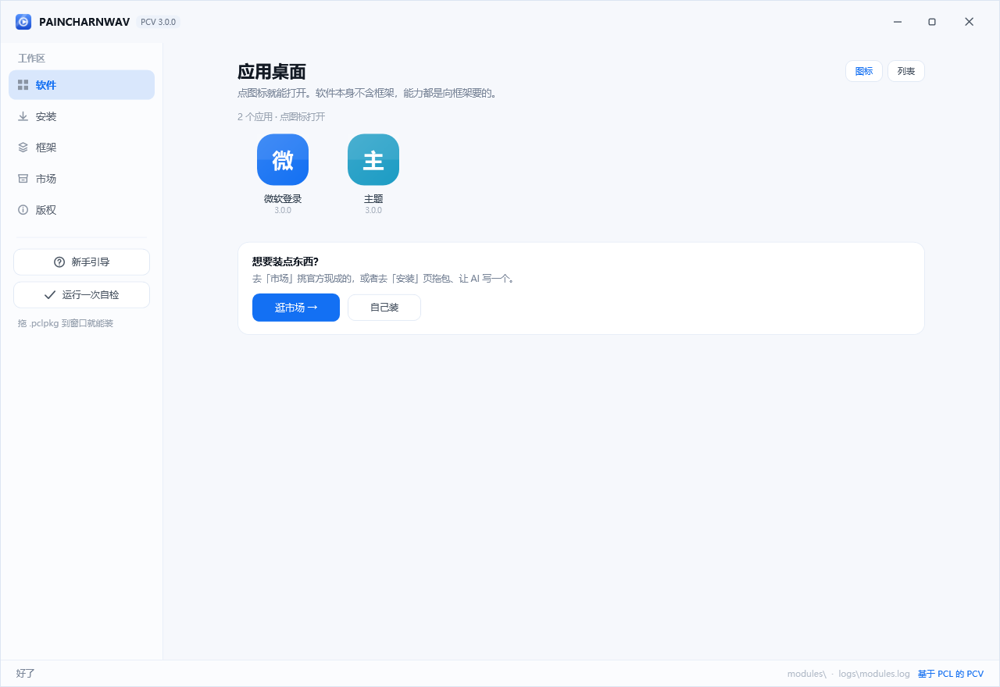
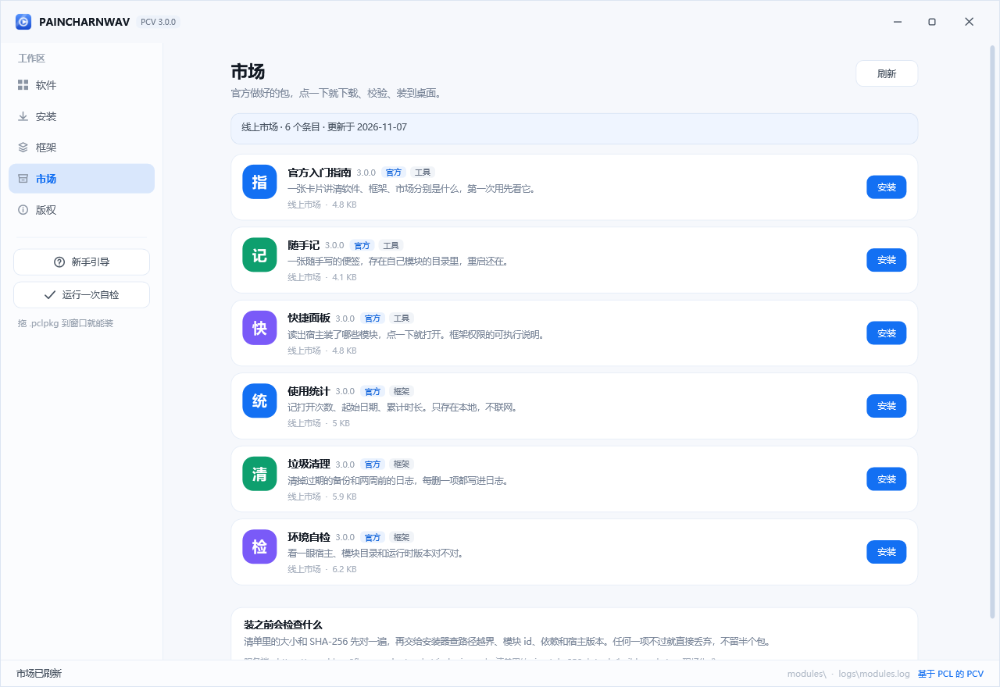

# PAINCHARNWAV（PCV）

**一个只负责装框架的壳。** 自己不带功能，能力全部来自可装卸的框架包。

[](https://github.com/150311-ma/PCV/releases/latest)
[](LICENSE)
[](#)

<p align="center">
  
</p>

---

## 它解决什么

普通启动器是「一个软件干所有事」，加功能就得改主程序，改多了就成一锅粥。
PCV 反过来：**壳只负责装、管、开**，每个能力是独立的一个包，可以单独装、单独卸、单独更新。

- 想要 Minecraft 启动？装 `pcv.mc.launcher`。
- 想要垃圾清理？装 `pcv.cleaner`。
- 自己写一个？拖个脚本进来，跑完自动装上。

壳本身永远不用改动。

## 快速开始

**安装**：下载 [`PCV-Setup-3.1.1.exe`](https://github.com/150311-ma/PCV/releases/latest)，双击。
装在 `%LOCALAPPDATA%\Programs\PAINCHARNWAV`，不需要管理员权限，桌面和开始菜单会有快捷方式。

静默安装（批量部署用）：

```bat
PCV-Setup-3.1.1.exe --silent --dir D:\Apps\PCV
```

**从源码构建**：

```bat
dotnet build Pcv.sln -c Release
python tools/build_market.py         :: 生成市场清单（dist 里的包当真相源）
python tools/check_repo.py           :: 仓库体检：版本号、文档引用、模块清单、市场清单
python tools/check_repo.py --inject-fault   :: 确认体检器自己没瞎
```

> 构建前先跑 `build_market.py`：壳工程会把 `market/index.json` 内嵌成断网兜底清单，
> 文件不存在时编译会直接失败（而不是装到用户机器上才发现没内容）。

## 界面：六页

| 页 | 管什么 |
| --- | --- |
| **桌面** | 已安装的应用，圆角图标网格，点一下打开；可切成列表视图卸载 |
| **安装** | 四条路：市场 / 拖包 / 挑文件 / 粘一段 AI 输出 |
| **框架** | 所有框架，按类别分组；基础框架带标记且不给「打开」 |
| **市场** | 官方做好的包，点一下下载、校验、装到桌面 |
| **版权** | 声明基于 PCL、上游作者署名与赞助链接、许可摘要 |
| **新手引导** | 初次启动自动停在这页，讲清软件 / 框架 / 怎么装；之后默认回桌面 |

启动即显示主窗口（默认落在桌面页）；想让它只留托盘图标后台跑，加 `--tray`。
初次启动会自动进新手引导，点「开始使用」记下状态，以后不再弹；
侧栏的「新手引导」随时能重看。

### 视觉：TRM UI 设计令牌

界面按 [TRM UI](https://github.com/Turing-Mirror/TRM-UI)（MIT）的设计系统重写。
它是 Web 组件库，所以这里移植的是**令牌与外壳布局**，不是引用它的 React 组件：

- 白色标题栏与侧栏，内容区向内收 8px 并带 14px 圆角，靠底色分区不画分隔线；
- 颜色、七档字号、两档圆角、字体栈统一放在
  `src/Pcv.Shell/Styles/TrmTheme.xaml`（浅色）与 `TrmTheme.Dark.xaml`（深色），
  两份字典 key 一一对应；标题栏那个「深 / 浅」小按钮随时可切，不用重开窗口；
- **界面里不许写死颜色**：XAML 用 `{DynamicResource TrmXxx}`，C# 用 `Trm.Xxx`，
  `tools/check_trm_theme.py` 在 CI 上闸这一条。写死的颜色在另一套主题下必然是错的，
  而且只有换主题那一刻才看得出来。

模块自带的框架界面还有一部分沿用各自写死的字色，框架窗口用浅色画布承载，
两套主题下都可读；这些界面本身暂不随主题变。

## 市场：两个来源

市场页顶上有「官方 / GitHub」两个来源，默认官方，切过去才发请求。

### 官方：博客当服务端

PCV 从 `https://cyan-blog-2fk.pages.dev/market/index.json` 拉清单，包是同目录下的
静态 `.pclpkg`。没有账号系统、没有数据库、没有上传接口 —— 就是几个静态文件，
符合「市场不要做太大」的口径。

清单真相源是 [`market/catalog.json`](market/catalog.json)，`size` / `sha256` / `version`
由 `tools/build_market.py` 现场从 `dist/` 算出来，不手抄。上架流程见
[market/README.md](market/README.md)。

### GitHub：谁做的模块都在他自己仓库里

PCV **不存任何社区模块**。约定只有三条：

1. 仓库打上 topic `pcv-module`；
2. 仓库根目录放一份 `pcv-module.json`（字段见下）；
3. `.pclpkg` 放在仓库里。

在市场里切到「GitHub」，输入模块名回车，PCV 就按 topic 搜仓库、逐个读清单。
读不到、字段不全、模块数字对不上的，直接跳过 —— 别人的仓库改不了，只能不信任。

```json
{
  "schema": 1,
  "id": "pcv.hello", "name": "打个招呼", "version": "1.0.0",
  "author": "yourname", "summary": "一句话说清它是干什么的",
  "category": "工具", "icon": "招", "accent": "#1370F3",
  "file": "pcv.hello-1.0.0.pclpkg",
  "size": 4936, "sha256": "…64 位十六进制…",
  "moduleCode": "PCV-2WRM-CMN2-24WT"
}
```

### 模块数字

每个模块有一个 `PCV-XXXX-XXXX-XXXX` 的号，**从内容算出来**，不是谁分配的：

```
sha256( id + "\n" + 版本 + "\n" + 包的 sha256 ) → 前 60 位 → Crockford Base32
```

同样的模块、同样的字节，在任何机器上算出来都是同一个号；改一个字节，号就变。
Crockford Base32 去掉了 `I L O U`，手抄不会把 `1` 认成 `I`、`0` 认成 `O`。
凭这个号就能核对「拿到的是不是创作者发的那一份」。

两端实现各一份（[`ModuleCode.cs`](src/Pcv.Modular.Packages/ModuleCode.cs) /
[`tools/module_code.py`](tools/module_code.py)），`tools/check_module_code.py` 用金标准
向量把两边钉在一起 —— 改算法必须同时改两处和向量，否则闸门会红。

客户端的安全与可用性处理：

- 下载完先比 `size` 与 `sha256`；社区模块再核一次模块数字，证明「和创作者发布的是同一个」；
- 清单里的 `file` 只接受纯文件名，拼不出任意 URL；
- 断网时退到「本地缓存 → 程序集内置清单」；离线时能看条目，安装会提示联网后再试；
- 本机到 Cloudflare 这段偶发返回截断正文（HTTP 200 但只有几百字节），
  所以清单和包都按「必须完整解析 / 校验通过」判定并重试 3 次；
- `raw.githubusercontent.com` 在部分网络下也是半死不活（握手过了、正文零字节），
  所以社区模块的清单和包都有 raw + `api.github.com` 两条路，任一条通就算成功。

<p align="center">
  
</p>

## 框架能用的宿主能力（`IHostControl`）

框架以前只能被宿主调用；现在可以通过 `context.Services.TryGet(out IHostControl host)`
请求宿主做事，能力列在
[`src/Pcv.Modular.Abstractions/Contracts.cs`](src/Pcv.Modular.Abstractions/Contracts.cs)：

| 能力 | 说明 |
| --- | --- |
| `Modules` | 已装模块的只读快照（纯数据 DTO，不是 `ModuleEntry`） |
| `Navigate` / `OpenModule` / `RefreshModules` | 切页、打开模块、重扫列表 |
| `InstallPackage` / `UninstallModule` | 装包仍走完整校验，基础模块卸载会被拒 |
| `Notify` / `CopyText` / `OpenUrl` | 状态栏、剪贴板、外部链接 |
| `HostChanged` | 模块列表或当前页面变化通知 |

**边界**：框架拿到的是接口，不是 WPF 窗口对象，改不了标题、遍历不了视觉树、
碰不到宿主私有字段。官方包 `pcv.official.dock`（快捷面板）就是这份能力的可执行说明。

## 概念：软件 与 框架

| | 软件 | 框架 |
| --- | --- | --- |
| 干什么 | 调用框架干活 | 提供能力 |
| 有没有界面 | 必须有 | 有就用，没有也行（进程型） |
| 能不能独立存在 | 不能，必须依赖至少一个框架 | 能 |
| 典型例子 | `pcv.app.demo` | `pcv.cleaner`、`pcv.mc.launcher` |

框架有两种形态：

| 形态 | 怎么跑 | 窗口 | 适合 |
| --- | --- | --- | --- |
| `assembly` | .NET 程序集，进程内加载 | 宿主渲染它给的 UI | 要贴宿主界面、要低延迟 |
| `process` | 任意语言（python / node / exe），独立进程 | 自带的深色控制台窗口 | 想用什么语言用什么语言 |

> ⚠️ **进程型框架不是沙箱。** 它拿不到宿主的内存对象，但文件系统层面和你是同一个用户权限。
> 别装来路不明的包——详见 [OPEN-SOURCE.md](OPEN-SOURCE.md)。

## 装东西的四条路

1. **去市场挑** —— 官方做好的包，点一下自动下载、校验、安装，桌面上多个图标。
2. **拖 `.pclpkg` 进来** —— 直接装。
3. **挑一个文件** —— 同上，走文件选择框。
4. **粘一段 AI 输出** —— 把 DeepSeek 给的构建脚本贴进来，点「构建并安装」：
   在隔离目录里跑完，产物自动装上，不用点第二次。带 markdown 围栏的也认（```` ```python ```` 会自动剥掉）。

## 一键自检

装不上、装完打不开的时候，不用去翻文件夹：点左侧栏底部的 **「运行一次自检」**。

<p align="center">
  
</p>

它查 9 项：模块图（启动时那次加载的结果）、`module.json` 能不能解析、入口文件在不在、
依赖关系、目录名与 id 是否一致、有没有排队等下次启动的更新、最近日志里的报错、
模块目录能不能写、契约 dll 在不在。结果分「通过 / 注意 / 失败」三档，
点「复制报告」就能整份贴进 Issue，不用手抄。

命令行也能开同一个窗口；配 `--render` 可以离屏出图，用来做自动化验证：

```bat
PCV.exe --selfcheck
PCV.exe --selfcheck --render selfcheck.png
```

> 自检里的模块图是**启动时那次的快照**，不会为了「刷新」把模块再启动一遍。
> 想验证「加载器本身能不能识别坏模块」，用 `Pcv.Modular.Cli.exe --inject-fault`——那另一个用途。

## 自己做一个包

写一个 `module.json` 加一个入口类，`pack_module.py` 打包，拖进 PCV 就装上了。

```json
{
  "id": "pcv.hello",
  "name": "打个招呼",
  "version": "1.0.0",
  "assembly": "Pcv.Hello.dll",
  "entry": "Pcv.Hello.HelloModule",
  "category": "framework",
  "dependencies": ["pcv.core"]
}
```

`category` 可以是 `framework` / `software`，也可以是**任意自定义类别**（如 `游戏`、`工具`），
界面会按它单独分组。

```bat
python tools/pack_module.py bin\Release dist\pcv.hello-1.0.0.pclpkg
```

更省事的办法：让 AI 帮你写。把 [`assets/prompt-framework.md`](assets/prompt-framework.md) 整段丢给
DeepSeek / ChatGPT，它会按格式生成一个完整的构建脚本，粘回 PCV 里就能装。

## 创作者工具：发到自己的 GitHub

PCV 里带一个「创作者工具」（市场页右上角），不用额外装东西。三步：

1. **选模块** —— 选打包好的 `.pclpkg`，或直接选模块目录（里面有 `module.json` 的那种，
   它会现场压成包）。它会顺手算出这个模块的数字，比如 `PCV-2WRM-CMN2-24WT`。
2. **填仓库和令牌** —— 仓库写成 `owner/name`；令牌要一个勾了 `repo` 的 classic token，
   窗口里有直达链接。令牌只在这台机器上用一次，不写进任何文件、不上传别处。
3. **上传并发布** —— 它做三件事：把包传进仓库、写 / 更新 `pcv-module.json`、
   给仓库打 `pcv-module` 标记。做完别人在市场里切到 GitHub 搜名字就能装。

发布前会走**和安装时同一套校验**（[`PackageInstaller.Inspect`](src/Pcv.Modular.Packages/PackageInstaller.cs)），
不另写一份规则 —— 能通过发布检查的包，别人一定装得上。唯一的区别：
发布检查不要求前置框架已经装在**你这台机器**上（作者机器上不一定装了）。


## 目录

每个目录都有自己的 README，这里只给一句话定位。

| 目录 | 是什么 | 详细 |
| --- | --- | --- |
| `src/` | 十六个工程，分四层：壳 / 加载与包管理 / 契约 / 模块 | [src/README.md](src/README.md) |
| `installer/` | 单文件安装器（自解压 + 快捷方式 + 卸载项） | [installer/README.md](installer/README.md) |
| `market/` | 市场清单的真相源与生成产物（服务端在博客） | [market/README.md](market/README.md) |
| `tools/` | 打包、打安装包、生成市场清单、生成宣传片与配音 | [tools/README.md](tools/README.md) |
| `samples/` | 五个示例：进程框架、软件、MC 启动、构建脚本、AI 生成脚本 | [samples/README.md](samples/README.md) |
| `assets/` | 图标 + 给 AI 的提示词 | [assets/README.md](assets/README.md) |
| `dist/` | 打包产物（安装包与 `.pclpkg`），**生成物，勿手改** | [dist/README.md](dist/README.md) |
| `docs/` | 界面截图、宣传片、B 站投稿包 | [docs/README.md](docs/README.md) |

根目录的几份文档各管一段，别互相抄：

| 文件 | 管什么 |
| --- | --- |
| `README.md` | 这是什么、怎么装、怎么用 |
| [ARCHITECTURE.md](ARCHITECTURE.md) | 分层、加载流程、包格式、边界 |
| [CHANGELOG.md](CHANGELOG.md) | 版本之间发生了什么 |
| [OPEN-SOURCE.md](OPEN-SOURCE.md) | 能做什么、不能做什么、名字能不能用 |
| [NOTICE.md](NOTICE.md) | 来源与署名（基于 PCL） |
| `LICENSE` | MIT 全文（本项目） |
| `LICENCE-PCL` | 上游的分发有限许可（仅作来源记录） |

## 随包安装的模块

| Id | 名称 | 版本 | 类别 |
| --- | --- | --- | --- |
| `pcv.core` | 基础模块 | 3.1.1 | framework |
| `pcv.theme` | 主题 | 3.1.1 | framework |
| `pcv.launch.microsoft` | 微软登录 | 3.1.1 | framework |
| `pcv.diagnostics` | 环境自检 | 3.1.1 | framework |
| `pcv.stat` | 使用统计（仅本地） | 3.1.1 | framework |
| `pcv.cleaner` | 垃圾清理 | 3.1.1 | framework |
| `pcv.demo.hello` | 示例框架 | 3.1.1 | framework |
| `pcv.py.demo` | Python 示例框架 | 3.1.1 | framework |
| `pcv.app.demo` | 示例软件 | 3.1.1 | software |
| `pcv.mc.launcher` | Minecraft 启动 | 3.1.1 | 游戏 |
| `pcv.rel.demo` | 相对路径示例 | 3.1.1 | framework |

这张表的 Id 必须和 `tools/build_installer.py` 的 `PACKAGES` 对得上——`tools/check_repo.py` 会查。

## 开发

| 想干什么 | 命令 |
| --- | --- |
| 构建 | `python tools/build_market.py`，再 `dotnet build Pcv.sln -c Release` |
| 仓库体检（版本 / 文档 / 清单 / 市场） | `python tools/check_repo.py` |
| 体检器自检（注入已知故障） | `python tools/check_repo.py --inject-fault` |
| TRM 主题体检（令牌对齐 / 界面无裸色） | `python tools/check_trm_theme.py` |
| 主题体检器自检 | `python tools/check_trm_theme.py --inject-fault` |
| 生成市场清单并自校验 | `python tools/build_market.py` |
| 市场清单校验器自检 | `python tools/build_market.py --inject-fault` |
| 同步市场到博客三处 | `python tools/build_market.py --blog <博客根目录>` |
| 打一个模块包 | `python tools/pack_module.py <目录> <输出.pclpkg>` |
| 打安装程序 | `python tools/build_installer.py` |
| 自检（模块图是否健康） | `Pcv.Modular.Cli.exe --modules <目录>` |
| 离屏渲染某页（截图用） | `PCV.exe --render out.png --page market` |
| 深色主题 / 验证已加载窗口换主题 | `PCV.exe --dark …` / `PCV.exe --switch-dark --render …` |
| 只留托盘图标、后台启动 | `PCV.exe --tray` |
| 打开自检窗口 | `PCV.exe --selfcheck` |
| 直接打开某个框架 | `PCV.exe --open pcv.theme` |
| 构建脚本并自动安装 | `PCV.exe --build 脚本.py` |
| 重出宣传片 / 配音版 | `python tools/make_promo.py`，再 `python tools/make_narrated.py` |

## 许可与来源

**源代码以 [MIT](LICENSE) 开源**——能做什么、不能做什么、名字能不能用，看 [OPEN-SOURCE.md](OPEN-SOURCE.md)。

这个项目是从 [PCL](https://github.com/Meloong-Git/PCL) 学来的：架构思路、契约设计、主题配色算法。
2.0.0 起代码已全部重写，不含上游源码；[`LICENCE-PCL`](LICENCE-PCL) 作为来源记录保留。
署名和感谢写在 [NOTICE.md](NOTICE.md)，程序「版权」页里也有一份。

界面设计令牌与外壳布局来自 [Turing-Mirror/TRM-UI](https://github.com/Turing-Mirror/TRM-UI)
（MIT），按其 `tokens.css` 翻成 WPF 资源；只用了令牌与设计约定，未复制其组件源码。

## 已知限制

- 框架是独立进程，但**不是内核沙箱**（文件系统层面仍是同一用户）。
- Minecraft：下载、离线登录、参数拼装都通了；1.17+ 需要对应版本 Java，**进游戏未完整验证**。
- 微软登录要自己申请 ClientId（配置 `MsClientId` 或环境变量 `PCL_MS_CLIENT_ID`）。
- 只支持 Windows 10/11，界面是 WPF（.NET Framework 4.8）。

## 更新记录

见 [CHANGELOG.md](CHANGELOG.md)。
